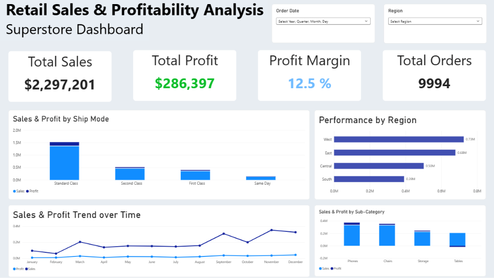

# 📊 Retail Sales & Profitability Analysis — Superstore Dashboard


Dokumentasi proyek analisis performa penjualan dan profitabilitas ritel menggunakan **Superstore Dataset** yang diimplementasikan dalam dashboard interaktif **Power BI**.

---

## 📸 Preview Dashboard


https://bit.ly/power_bi_view

---

## 📌 Ringkasan Proyek (Project Overview)

Dashboard ini dirancang untuk memberikan wawasan eksekutif (*executive level insights*) mengenai performa keuangan dan operasional dari Superstore Ritel. Fokus utama analisis meliputi:

1. **Efisiensi Logistik & Pengiriman:** Evaluasi kontribusi moda pengiriman (*Ship Mode*) terhadap penjualan dan profit.
2. **Kinerja Geografis:** Pemetaaan wilayah (*Region*) dengan pendapatan tertinggi dan terendah.
3. **Analisis Tren Penjualan:** Identifikasi pola musiman (*seasonality*) pendapatan bulanan.
4. **Profitabilitas Produk:** Analisis sub-kategori produk (*Sub-Category*) yang menghasilkan keuntungan vs kerugian.

---

## 📂 Struktur Repositori (Folder Structure)

```text
superstore-sales-analysis/
│
├── 📄 README.md                        # Dokumentasi utama proyek
├── 📁 dashboard/
│   └── 🖼️ dashboard.png                 # Tangkapan layar 
├── 📁 data/
      📁 raw/
       └── 📊 raw-superstore.csv       # Dataset mentah 
      📁 processed/
       └── 📊 category_analysis.csv       
       └── 📊 monthly_clean.csv       
       └── 📊 superstore_clean.csv       # Dataset bersih
└── 📁 notebook/
    └── 📈 retail_analysis.ipynb   
```

---

## 📈 Indikator Kinerja Utama (KPI Metrics)

Dataset berisi 9,994 transaksi:

| Metrik | Nilai | Keterangan |
| :--- | :---: | :--- |
| **Total Sales** | **\$2,297,201** | Total akumulasi pendapatan kotor |
| **Total Profit** | **\$286,397** | Keuntungan bersih setelah biaya |
| **Profit Margin** | **12.5 %** | Persentase marjin keuntungan bersih (`Profit / Sales`) |
| **Total Orders** | **9,994** | Jumlah seluruh volume pesanan pelanggan |

---

## 🛠️ Formulas & DAX Measures

Berikut adalah kumpulan rumus **DAX** utama yang digunakan dalam pengembangan model data Power BI:

```dax
// 1. Total Sales
Total Sales = 
SUM(Orders[Sales])

// 2. Total Profit
Total Profit = 
SUM(Orders[Profit])

// 3. Profit Margin (%)
Profit Margin = 
DIVIDE(
    [Total Profit], 
    [Total Sales], 
    0
)

// 4. Total Volume Orders
Total Orders = 
DISTINCTCOUNT(Orders[Order ID])

// 5. Total Quantity Sold
Total Quantity = 
SUM(Orders[Quantity])
```

---

## 🔍 Penjelasan Komponen Visual & Insight

### 1. Header & Slicers (Atas)
* **Order Date:** Slicer hierarkis waktu (*Year, Quarter, Month, Day*) untuk analisis fleksibel.
* **Region:** Slicer filter wilayah pasar (*West, East, Central, South*).

### 2. Sales & Profit by Ship Mode (Middle Left)
* **Tipe Visual:** Stacked Column Chart
* **Insight:** Moda pengiriman **Standard Class** mendominasi total penjualan (> \$1.5M) dan menyumbang profit terbesar, diikuti oleh *Second Class*, *First Class*, dan *Same Day*.

### 3. Performance by Region (Middle Right)
* **Tipe Visual:** Horizontal Bar Chart
* **Insight:** 
  * **West** merupakan pasar terkuat dengan total penjualan sebesar **\$0.73M**.
  * **East** menyusul di peringkat kedua dengan **\$0.68M**.
  * Wilayah **South** memiliki kontribusi penjualan paling rendah (**\$0.39M**).

### 4. Sales & Profit Trend over Time (Bottom Left)
* **Tipe Visual:** Dual Line Chart
* **Insight:** Penjualan mengalami lonjakan musiman (*seasonality pattern*) konsisten pada bulan **Maret**, **September**, dan puncaknya di bulan **November**. Margins profit cenderung stabil mengiringi garis tren penjualan.

### 5. Sales & Profit by Sub-Category (Bottom Right)
* **Tipe Visual:** Stacked Bar Chart
* **Insight Kritis:**
  * Sub-kategori **Phones** dan **Chairs** menghasilkan pendapatan dan profit tertinggi.
  * Sub-kategori **Tables** berkinerja buruk: Meskipun memiliki tingkat penjualan yang tinggi (~ \$0.2M), nilai profitnya bernilai **negatif (rugi)**.

---

## 💡 Rekomendasi Bisnis (Actionable Insights)

1. **Restrukturisasi Harga Sub-Kategori 'Tables':** 
   Batasi tingkat diskon maksimal untuk produk *Tables* guna menghentikan marjin negatif/kerugian operasional.
2. **Perencanaan Inventaris Musiman (Q4 Peak):** 
   Tingkatkan kapasitas stok gudang pada bulan Agustus–Oktober untuk mengantisipasi lonjakan permintaan puncak di bulan November dan Desember.
3. **Strategi Penetrasi Pasar Wilayah South:** 
   Evaluasi program pemasaran dan biaya distribusi di wilayah *South* yang masih tertinggal dibandingkan wilayah *West* dan *East*.

---
